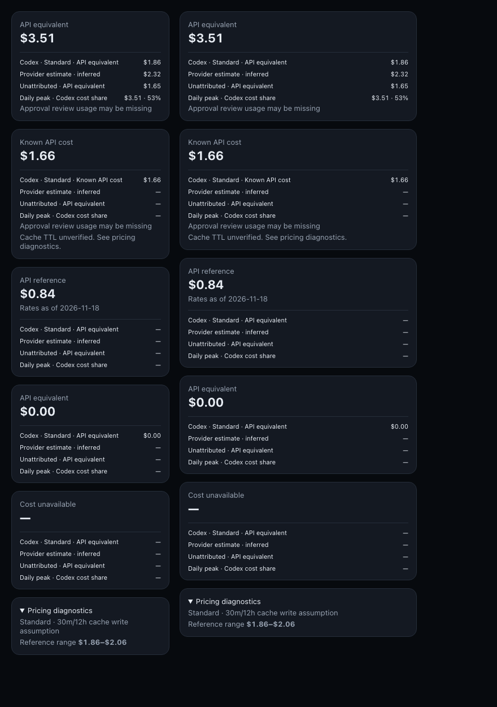

# 菜单栏计价展示

沿用共享 [产品原型](../../../../prototype/README.md) 的期间金额位置和 280/420 宽度。主金额从 `pricing.api_equivalent` 读取，同一筛选范围的渠道估算仅在详情显示。按日期、客户端或执行档切换时，标签和覆盖跟随相同范围。[计价契约](../architecture.md)

| Amount | 中文标本 | English specimen |
| --- | --- | --- |
| 完整的公开 API 口径 | API 等价 $3.51 | API equivalent $3.51 |
| 渠道费用估算 | 渠道估算 $2.32 | Provider estimate $2.32 |
| 部分已知 | 已知 API 金额 $1.66 | Known API cost $1.66 |
| 同一口径完整参考 | API 参考 $0.84 | API reference $0.84 |
| 确认零费率 | API 等价 $0.00 | API equivalent $0.00 |
| 缺失 | 金额不可用 | Cost unavailable |

新投影使用 `已知` 表达部分小计，`参考` 表达假设下的整段金额。旧 wire 无新字段时仍采用旧 `≈` 和原金额。规则有效日期、TTL 区间、缺价与部分值的解释放在现有诊断详情。按客户端和档位的次行复用同一口径。推断归因可在有证的子集显示渠道估算并带归因标签。未归因行可以显示 API 等价，渠道字段为不可用。参考或部分金额仅作呈现，不参与金额排序和峰值。价卡切换时沿用原快照新鲜度反馈。

每种主状态保留客户端、档位、推断归因、未归属、峰值和占比的位置，并在不可比时显示留空值。部分状态的主卡只提示查看诊断，两个 TTL 候选和参考区间在独立诊断详情中显示，金额区间作为整体换行。所选期间有 `activity_coverage_unavailable` 时，诊断位显示审批审查用量可能缺失。该告知不改变主金额状态。

复现入口为 `npm run build:single` 后打开 `preview.html?surface=pricing-menubar`。同一共享原型可切换中英文和外观。标本覆盖金额标签、次行及窄宽适配。原生验收继续用实际窗口或原生 fixture 检验 VoiceOver、窗口字体及快照切换。

图像 SHA-256 为 `7f5d3c19a920f95a625dfa4df076b45a2ce3d01fe1509b04572703a15d6be999`。菜单栏标本清单 SHA-256 为 `bdb1785b185cae443b2365092557e45e934bec67ae6c4812ef5d58d020bc1c5e`。清单以 `prototype/src/PricingSpecimens.jsx`、`pricingSpecimens.css`、`main.jsx`、`styles.css`、`prototype/package-lock.json`、`prototype/specimens/pricing-menubar.png` 的固定顺序，在仓库根目录输出 SHA-256 及相对路径后取摘要。评审范围为 `pricing-menubar` 的状态与依赖。
