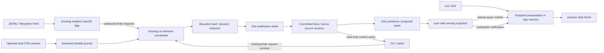
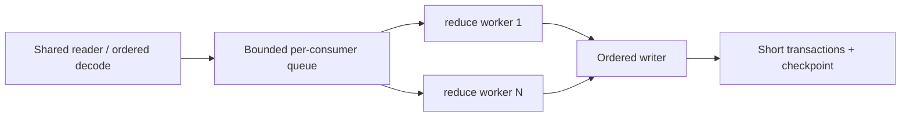

# 展示恢复、事件更新与有界采集

完整契约。依赖 [requirements.md](requirements.md)、[菜单栏](ux/menubar.md)、
[CLI](ux/cli.md) 和 [性能评估与测量契约](performance-evaluation.md)。
2026-10-22 全 topic 重新设计：依据已有实测重新取舍打开路径、启动顺序、usage 消费并行化、
短事务与测量打点；serving 快照、coverage、生命周期、OTel 等已评审契约保持不变。

## 当前代码与改变的位置

源码事实绑定分支 HEAD `c6ea1ca6551f525cc8a757ccf2e7889fabf36402` 加工作区内未提交的
旧 `bounded-source-pipeline` 任务的候选（`internal/ingest/parallel_decode.go`、`activity.ScanMessage` 单遍扫描、
可写连接 `temp_store=MEMORY` 及相关测试）：

| 当前边界 | 已核实事实 | 本设计变化 |
| --- | --- | --- |
| `apps/macos/AgentDeckApp/MenuBarItemController.swift` | `NSPopover` + 常驻 `NSHostingController`；ready 后在未上屏的借用窗口中预布局一次（`popoverPreparation`）；`togglePopover` 直接 show；DEBUG 内含 Vision/OCR 基线采集 | 按打开路径一节处理首击；删除 DEBUG 基线采集与 OCR；接入数据帧打点 |
| `apps/macos/AgentDeckApp/MenuBarViewModel.swift` | 从 coordinator 转 presentation，默认 quota/today/all | 读取已准备 publication；按 publication+selection memoize；切换意图为公开入口供 P03 打点 |
| `apps/macos/AgentDeckShared/EmbeddedHelperRunner.swift` | 启动恢复、quota、bootstrap 并行；helper 按需启动 | 启动顺序改为恢复优先（见下）；额度与数据更新仍与首屏解耦 |
| `apps/macos/AgentDeckShared/DesktopRefreshScheduler.swift` | FSEvents（latency 0.1 s）触发有限更新 | 保留；打点 `source.fsevent`；合并与漏事件校对见事件更新 |
| `apps/macos/AgentDeckShared/DesktopLog.swift` | `DesktopPerformanceStage` 固定阶段与有限 trace | 由 `PerfTrace` 取代（单调时钟、默认关闭、跨进程同源） |
| `internal/desktop` serving / `internal/store` generation 与 coverage | serving snapshot、generation vector、持久 inventory/coverage、当天 bootstrap 已实现 | 契约不变；补短事务切分与打点 |
| `internal/ingest/ingest.go` | 共享 reader + 预算 admission；usage/session 两个 consumer 各一条消费循环；≥1 MiB 独占 source 4 worker 有序解码（候选） | 保留共享读与有序解码；预算覆盖新增的并行 reduce |
| `internal/usage/usage.go` | `scanInventory` 逐 source 串行调用 `scanFileMode`，同一 goroutine 内完成 parse、activity 分类、会话重建与 SQL 写入；profile 约占 27% CPU | 拆成并行 source reduce + 单一有序写者（见流水线一节） |
| `internal/session/session.go` | `scanMode` 逐 source 串行 `scanOne` | 同一模式，按 E1 关键路径证据决定是否并行化 |
| `internal/scanruntime/scanruntime.go` | 单协调者、有限 round、receipt、subscriber-only cancellation、首批发布 | 契约不变 |
| `cmd/agentdeck/main.go` 与 [CLI Manual](../../specs/cli-manual.md) | scan 同步；stats/summary 有 `--no-scan` | 共用已提交事实与发布结果；保留当前命令语义 |
| `scripts/scan-performance-*`、`scripts/scan_performance_*`、`scripts/p07*` | 历次实验各自的私有 harness | 由 `cmd/agentdeck-perf` 与产品内打点取代后删除 |
| `prototype/tools/scan-performance-*` | 8 个文件，由 `ux/prototype/serving/manifest.json` 以路径与 SHA-256 固定，并由 `prototype/README.md` 列为标本 harness | 保留为已评审 UX 标本的一部分，不删除、不修改，也不作为任何指标的测量工具 |

CodeGraph 用于关系定位；SQL、Swift 生命周期和磁盘缓存直接核对源码。
运行时耗时以测量契约为准，不把这张表当作性能根因证明。

## 按数据是否已经整理选择启动路径

1. **库空：** 一次metadata发现，先排今天日期相关/今天修改的来源，旧活跃会话也纳入。
   第一批usage/session必要事实提交后，生成今天可用视图并发布；继续处理历史。
   目录和mtime只决定优先级，全量inventory保留；覆盖未知时用partial，其他窗口不能声称完整。
2. **已有库：** 有有效展示保存文件就恢复；没有则直接读今天的已提交事实。
   不先调用global scan，也不因现有Presentation同时准备90天/7d/30d而阻塞首批今天视图。
   周/月、工作信号、会话详情按需/后台准备；缺失项目数等显示—而非0。
3. **今天尚未采集：** 旧有效视图先供阅读，增量任务处理新日志并须满足 P10。
   usage 域可先提交先发布；处理耗时由并行 reduce 与增量投影承担，不靠缩小查询范围。
4. **发布不依赖全局终结：** 采用现有域进度/有限任务能力，在安全提交点产生partial publication。
   Native reader读取不可等待全局worker释放锁；发布文件只对应已提交generation vector。
   历史重算使数据较旧/部分，不使身份仍有效的首批视图消失。

实验的private day-hint过滤仅用于空库对照，绝不能直接移入产品的全局Discover：
已有库遗漏来源可能被解释为删除。产品实现应保留全inventory，分批调度并携带coverage。
CLI显式全范围scan/报告不因App首批今天已经可用而提前返回完整成功。

## 系统结构

第一阶段不新增常驻 Go daemon。已有 macOS App 管理首次当天准备、已有库读取、展示恢复和文件通知，
现有按需 helper 完成有限更新后退出。这能独立检验最小改动的实际收益，
避免把启动恢复、扫描重写、IPC 升级和多进程同时打包而无法归因。

Usage 与 session 两个 consumer 目前各以一条循环逐 source 处理，usage 一侧在全量重建中是串行瓶颈。
本设计把每个 consumer 内部拆成“并行 source reduce → 单一有序写者”：reduce 纯计算、不碰 SQL，
写者按 inventory 顺序提交，因此写入顺序、跨 source 所有权判定与串行实现一致。
worker 数按测量契约的完整周期规则在 1/2/4/8 中选择，受统一内存预算约束。
默认不启动 parser 子进程，多进程 adoption 必须满足候选采用规则。
OTel 接收必须持续存活，可由显式启用的 App 随行 receiver 满足；这项连续接收需求
与 popover 快开收益分开评估。OTel off 时快开不依赖 receiver。

实施顺序：测量工具与基线 → 打开路径与启动恢复 ∥ 并行 reduce 与短事务 → 增量更新 →
文件事件合并与 CLI 衔接 → OTel（Bug 修复载体，见需求·OTel）→ 全矩阵验收。若 P10 分段证明 helper 启动/身份重建占主导，
才采用下面的常驻扩展。

## 打开路径

点击路径只做：`handleClick` → `togglePopover` → `NSPopover.show` → 已有 hosting view 首次/再次上屏。
不读 SQL、不解码、不启动 helper、不 await 任何异步工作。S0 实测（E1）首击 p95 470 ms、重复点击中位 351 ms /
p95 512 ms；首击成本主要在首次窗口创建、布局与提交。重复点击的成本来源尚未分段：现有代码已保留同一 hosting
controller，只在高度变化时替换 root，关闭只 `performClose`（`MenuBarItemController.configurePopoverGeometry`
与关闭路径，S0 相同），端到端中位不能区分 SwiftUI 视图重算、重新布局、提交/刷新等待或后台争用。2026-10-27
用户决定不设数值目标，下列各步都是优化，不是决策门；每步以 P01 分段打点（`input.event`、`popover.show.*`、
`popover.layout.data`、`frame.commit`、`frame.vsync`）衡量收益，按[候选采用规则](performance-evaluation.md#候选采用规则)
决定保留或撤回：

1. **分段定位。** 首击与重复点击分别给出各段分布，确认成本落在 show、布局还是提交/上屏。
2. **首次窗口暖启动。** 现有预布局只让 hosting view 在借用窗口里完成布局，NSPopover 自己的窗口、后备存储与
   window server 侧资源仍在第一次 `show` 时创建。`model.usable` 之后、主线程空闲时，对同一 NSPopover
   以状态栏按钮为锚执行一次 `show`，在同一 MainActor 回合内（首个 Core Animation 提交之前）把其窗口
   `alphaValue` 置 0、`ignoresMouseEvents` 置真，不调用 `activatePopoverWindow`、不请求 key，
   保持一个提交周期后 `performClose` 并恢复 alpha 与鼠标事件。只执行一次；用户在暖启动期间点击时，
   先完成关闭再按正常路径打开。约束（正确性要求）：不产生可见帧、不改变前台应用与 key 窗口、
   不触发 helper 或数据读取。静态内容探测中它把首击中位由约 147 ms 降至约 94 ms（见性能评估“已停止的首击窗口探测”）。
3. **预热放到 ready 之后、空闲时。** 保留现有借用窗口预布局，补齐首次上屏所需的其余一次性成本
   （字体/材质/图层与 display link 初始化），在主线程空闲时分片执行，单片 ≤8 ms，避免拖慢启动恢复与重复点击。
4. **首帧内容最小化。** 首帧只需要当前选择的 hero 与当前面板的可见部分；
   其余面板与折叠区内容在首帧之后构建。这不改变可见内容与交互，只改变构建时机。
5. **保持同一 hosting 层级与控件身份；重复打开的成本按分段处理。** 关闭不销毁 content；几何变化只更新 root，
   不重建控制器（行为约束，现有代码已满足）。“再次打开重新计算 presentation 或重建视图树”是待验证假设：
   先用第 1 步的重复点击分段与 Perf 构建中的视图/控制器身份观察（`body` 求值次数、hosting controller 与 root
   身份是否变化）区分重复构建与布局/提交成本；只有观察到 publication 与选择未变时仍重复构建，才实施“未变时
   不重算 presentation、不重建视图树”，并按候选采用规则以重复点击分段衡量；否则按实测的主导段处理。
6. **启动争用削减。** 见下。

既定 UX 要求“复用既有 popover”，不以自绘面板或其他窗口形态替代 NSPopover。

#### 启动争用削减

`model.usable` 之后启动全量刷新与首击、P02 争用。实测在数据未变（读取 0 字节、导入 0 条）时，这次扫描仍在
发布阶段完整重建 serving 视图约 0.6–1.1 s（`internal/scanruntime/serving.go` 与 `scanruntime.go` 的 derive 段）。
两个候选按候选采用规则一次一个实施，以 P01 首击、P02、P04、P11 衡量收益：

1. **未变化时复用派生投影，不复用整份 payload（2026-10-27 修订）。** serving payload 不是 generation 的纯函数：
   `Build` 每次按当前时钟写入 `GeneratedAt`、`NextRefreshAt`，并重新加载 provider、subscription（额度
   `Stale` 按 now 与阈值计算，跨阈值不写库）、sessions 与 health。因此发布段仍每次调用 `Build`，下列
   字段总是按当次时钟重建，不复用：生成与下次刷新时间、provider、subscription/额度新鲜度、sessions、
   health、warnings 与 coverage 头。可复用的只有 usage 摘要/presentation 与 work signals 这一稳定投影，且只经由
   已有的派生快照缓存（`internal/desktop/derived_cache.go`）复用，沿用它已评审的键与有效期：数据库身份、
   schema、usage/session parser 与算法版本、wire 版本、epoch 与 revision 且未 dirty、时区与本地日窗口，
   以及 `ValidUntil` = 下一整点、下一本地日与未来价格生效时间中最早者；任一不符或到期即重算。本候选不新增
   复用键、不扩大有效期、不跳过 `Build`。
   本候选要消除的是无变化扫描里派生投影的重复计算。实现第一步在工作副本上连续两次扫描，按打点确认第二次
   发布段重算投影的原因，只处理以下两类：
   - 无事实变化的写入把派生 generation 置 dirty 或推进 revision；只在不改 schema 与 revision 触发器的前提下
     消除这类无效写入，否则停止并返回设计。
   - 同一 derive 段内 `PublishDerivedSnapshotCache` 与 `Build` 重复计算同一投影；改为前者写好缓存后由
     `Build` 命中，不另算。
   `ValidUntil` 到期等合法失效照常重算，不绕过；若重算全部来自合法失效，本候选没有收益，不实施，直接进入候选 2。
   正确性 oracle：同一数据库、同一注入时钟（`Service.Now` 固定）、同一请求下，命中缓存路径与强制重算路径
   产出的 serving payload 逐字节相等；不跨时刻比较。边界验证：同一 generation、同日内额度跨 stale 阈值前后
   （例：300 分钟窗口、5 分钟 probe interval，观察后第 29 与第 31 分钟）两次发布的 `Stale` 分别为 false、true；
   跨整点、跨未来价格生效时间、跨本地日、dirty 或 revision 变化时都重算投影；sessions 与 health 每次重新加载。
   变化数据的分区重算仍属 `incremental-update`。
2. **启动后台工作低优先级调度。** `model.usable` 之后由启动顺序发起的 helper（quota、bootstrap、启动
   全量刷新）以 `Process.qualityOfService = .utility` 启动；恢复成功（已有有效 publication）时，该回合由
   `internal/scanruntime` 拉起的扫描 worker 降低自身调度优先级（darwin `setpriority`，nice 10）。
   无缓存与空库（P04/P11）的回合保持默认优先级，首批发布不被延后。只改调度，不改语义、兜底与超时。

不推迟启动刷新的开始时机：那会改变启动后的数据新鲜度，属于需求变更。

切换（P03）只在已准备的 publication 内重新投影，presentation 按 `(publication_id, selection)` memoize；
切换意图入口是 view model 的公开方法，测量与控件 action 走同一入口。

## 启动顺序

已测 App-ready → 可用模型 p95 1,105 ms，超出 P02 的 750 ms；恢复本身在早期实验中约 15 ms，
差额来自启动期争用。启动顺序固定为：

1. `app.ready` 后立即在高优先级后台任务做只读身份检查与 serving 文件读取/校验/解码，
   prepared view 在后台构建，MainActor 只交换 publication。
2. 恢复完成（或身份未知/缓存不可用，转入 P04/P11 路径）之前，不启动 quota 网络请求、
   bootstrap helper、预热分片或 watcher 首轮校对；它们在 `model.usable` 之后依次开始。
   这不改变它们的语义，只改变开始时机；若 750 ms 内恢复未完成，它们照常开始，不被无限推迟。
3. 无缓存时（P04）与空库（P11）沿用当天优先 bootstrap，首批发布不等待全局 scan terminal。

## 生命周期与所有权

### 默认有限模式

App 持有 watcher/展示订阅；退出停止其事件接收与App-only历史补齐，在有界checkpoint暂停。
为此有限worker也需要记录App作业所有权和暂停策略，不靠关闭popover或取消订阅来推断取消。
CLI已接受的有限义务依既有receipt完成，App退出不能取消它；不改变普通CLI的subscriber-only cancellation。
App 和 CLI 仍只有一个写入协调者。在source/domain安全提交检查点原子发布serving文件，
不等扫描终结。App监听独立publication通知，校验后交换内存；CLI完整请求仍等其有限范围完成。
漏通知在启动/唤醒/明确丢事件提示时有限校对，不用固定刷新周期作为正常更新机制。

首批流程：优先batch的事实和coverage checkpoint提交 → projector读取一致的已提交vector，
将未完成域置unavailable → 校验/原子写serving文件 → 发出publication_ready通知。
usage先提交可先发布，不借旧session值补项目数。后续batch、域或coverage改变可触发新publication；
按publication ID合并，terminal不是首次发布条件。

App新增独立serving订阅/文件变更入口，异步read/decode后绑定可用publication。
此入口不await旧runner的scanIndexes、waitForCompletedScanWorkerToReleaseLock或host.refresh返回。
coordinator接收首批更新latestSnapshot，fullAttempt/scanProgress仍running；
全局terminal结束请求并发布最终coverage。新内部publication通知与外部scan NDJSON v1分开协商，
不能给旧v1流添加未定义事件。漏通知以保存的publication ID有限校对。

### 有条件的常驻扩展

以下 lease/新版 IPC 是保留的扩展设计，不是第一阶段或快开的前置依赖。
只有持续 OTel 接收/多订阅者确需此模式，或相同输入实验证明进程开销值得移除时才启用。

### 扩展：一个 state root，一个协调者

复用私有 state-root identity、现有本地 socket/锁与 receipt 存储。
锁作用域是引擎 writer 的所有权，不是在一个长 round 内持有 SQL transaction。
状态更新以 SQLite 的短事务和 writer 队列串行；maintenance/restore 使用现有维护边界，
先暂停任务和 publication，不能绕过已有扫描/迁移锁。

lease 分三种：

| lease | 创建条件 | 结束条件 |
| --- | --- | --- |
| App | App 启动并成功绑定引擎 | App quit/disconnect；引擎验证 peer/process identity 后回收 |
| independent | 操作者显式 `engine start` | `engine stop` 移除此 lease；不影响仍在运行的 App lease |
| finite task | CLI 的同步 scan/watch 或一次有限刷新 | 请求的 finite work 完成或 watch 显式停止；客户端断连不取消已接受的 scan |

App lease 用受限本地连接和 peer PID/start identity 验证，不用单一 PID 或 actor 名字当身份。
连接关闭触发撤销；App 崩溃必须在 ≤2 秒检测窗口内停止 App-owned watch/new work。
正常退出给予最多 2 秒 checkpoint grace，随后关闭 receiver/watcher。未提交事务 rollback；
已提交 cursor 与 journal 不丢弃，App-owned 重建标为 paused。无需后台模型请求或 OS 登录项。

App quit 时若独立 lease 存在，引擎按操作者选择继续；若只有 CLI 已接受的有限任务，
App resident mode 结束，但按需模式保留该任务直到其契约完成，然后退出。
这是 CLI 自己的工作，不是隐式启用独立后台采集。没有 lease/有限任务时进程退出。
heartbeat 只用于故障诊断，不能每秒唤醒一个空闲 App；本地连接断开与进程终止通知优先。

自动更新偏好控制 JSONL 文件监听；开启后按事件触发，无需用户设定刷新周期，关闭后不偷偷监听/轮询。
启动的一次有限更新、手动刷新、CLI scan 和显式 OTel 接收是各自被授权的来源。
独立 mode 的周期行为使用同一配置，不能凭常驻推导所有采集都默认开启。

### 扩展：IPC 与版本

在现有 private Unix socket 的 handshake 上协商 `protocol_version`、binary/build identity、
state identity 与 capabilities：`serving_read`、`finite_scan`、`publication_subscription`、
`app_lease`、`telemetry_capture`、`telemetry_reconciled`。具体新 protocol 数字在实现时
按现有协议分配；不能复用旧数字承载新语义。外部 scan NDJSON 的 v1 不因内部升级改动。

- 已兼容的引擎：App/CLI attach，不再 launch worker。
- 引擎不存在：App 创建 resident lease；CLI 创建 finite lease，完成后按需退出。
- 旧 v1 worker：旧命令按原 finite_scan 能力使用；App 不声称新快开能力已成立。
- 新 CLI 遇到不兼容引擎：明确 `engine_protocol_mismatch`；只读存储模式仍可使用。
  不擅自 kill、替换或启动第二 writer。升级在任务安全 checkpoint/维护边界显式重启。
- 不同 state root/HOME：不得共享引擎、cache 或 receipts。

IPC 消息均有 size limit、deadline、request ID 与 state ID；只包含任务范围、aggregate
progress、publication ID 和必要结果，不传日志正文或凭据。socket/目录 0700，持久文件 0600，
拒绝 symlink、错误 owner/mode 和不一致 identity。队列超限返回可诊断 busy，不无限内存排队。

## 展示快照契约

### 两种缓存，不混用

`desktop-derived-cache.json` 继续是计算复用缓存：cache hit 要严格匹配计算输入。
新 `desktop-serving-snapshot.json` 是展示恢复文件：包含一次已经验证可显示的完整 payload，
即便更新正在运行也能读取。dirty 或旧 revision 标记其 age/coverage，不直接删去旧文件。

serving header：`format_version`、`wire_version`、`state_identity`、`core_epoch`、
`session_epoch`、`core_schema`、`session_schema`、`publication_id`、`active_generation`、
`usage_revision`、`session_revision`、`projection_version`、`pricing_revision`、
`timezone`、`window_start/end`、`generated_at`、`data_observed_through`、`checksum`。
payload 包含现有各客户端/时段的 usage presentation、provider 展示字段、recent sessions、
work signals、最后的只读 health 观察和 subscription/额度 observations。
不含 credential 值、日志正文、OTel raw bodies。敏感动作不使用 cached provider 为执行真相。

文件上限沿用 8 MiB；超限保留旧有效文件并报告 `serving_payload_limit`，不能静默删行。
常用视图先准备，CLI 任意查询不强迫进入这个文件。必要的 UI 模型封顶沿用已批准规则，
不通过降低数据范围假装达到上限。各 observation 保留自身时间，generated_at 不是 fresh 证明。

发布步骤：构造 prepared payload → 校验完整字段/coverage → 重验 generation vector →
0700 目录内 0600 temporary write → file fsync → atomic rename → directory fsync →
发出 publication notification。新文件验证失败不能替换最后有效快照。
Swift 对一个 immutable publication 原子替换，不能逐字段显示一半新一半旧的 totals/model mix。

### 恢复与 MainActor

App 在显示 status item 的同时，后台做轻量 read-only identity check：core/session 的 epoch/schema
各单行读取，global startup identity deadline 200 ms，SQLite busy timeout 有界。不迁移、不发现日志。
只有身份已验证才恢复缓存；检查超时是身份未知，不能为了 P02 显示来自另一个库的数字。
已运行 App 保留这次 verified identity，不在每次 click 读 SQL。

后台校验、decode、格式化与 prepared-view 构建后，MainActor 只交换 publication/view model。
点击不 await 引擎、helper、disk read 或网络；已经存在的 memory publication 直接 bind。
打开路径的优化以 `PerfTrace` 分段为依据（见“打开路径”），不在缺少测量时重写整个 UI。

无 serving cache但有已提交数据库：优先用今天的indexed read/派生 partitions 构建首批展示，
禁止先扫描日志。完全首次导入：先发布带 unavailable 组的结构，再在来源 chunk 提交后
发布诚实的部分数据。数据恢复完成与一次 global scan 完成是不同事件。
已有usage stats --period today --no-scan在当前语料可约104ms供给基础用量，
但不是完整popover envelope。正式projector需把这些数据接到版本化availability/coverage，
并在后台补其他字段；不能以改CLI输出冒充完整native视图已验收。

### 日期和失效

restore、core/session rebuild、state-root 变化：mint 新 epoch，旧 serving 文件 fail closed。
算法升级或 parser 重算：旧 compatible publication 可继续以 `rebuilding` 显示；新 generation
通过后切换。未来 schema/wire 按原 signal 显示，不将不兼容 payload 解释成较旧可用数据。

跨天/DST/时区变更立即使 date-specific prepared view 失效。先将 today 显示 unavailable，
仍允许查看匹配实际窗口的历史视图；后台基于已存 daily facts 重建新窗口。
不能把昨日 totals 重新贴上今天日期，也不能未采集就给新一天 zero。

## Coverage 与字段供给

展示 wire 新版本增加独立 metadata，不把 freshness、scan state 和完整性合成一个 boolean：

| UX 需要 | 字段与 producer | 规则 |
| --- | --- | --- |
| 可读数据身份 | publication_id + generation vector；projector | 同屏用量、构成和归因来自同一 publication |
| 数据年龄 | generated_at、各组 observed_through；producer | 打开/重试不更新数据时间 |
| 较旧但可用 | freshness=`current/stale`；projector 比较 watermark | stale 可显示，identity invalid 不可显示 |
| 初始/部分/完整 | 每 view/domain coverage=`complete/partial/unknown/unavailable` | `complete` 仅相对声明的 inventory/source set，不代表未启用 OTel 的所有真实消耗 |
| 后台等待/执行/暂停/失败 | job_state + reason_code；scheduler | queue_wait 与 processing 分开；超时退出订阅不改 job_state |
| 历史遗漏 | telemetry coverage intervals + gaps；receiver/reconciler | 无 exporter 时历史=`unknown`，不伪造 gap 起点 |
| 额度年龄与失败 | 现有 subscription observation 时间/status | 与 usage publication 时间独立 |
| 新日不可用 | view.window + coverage；projector | 未知不是 0，旧值不进新窗 |
| CLI 已完成范围 | request receipt.inventory_id/domain watermark | 有限请求可结束，持续实时数据另轮处理 |

wire-v1 helpers/Widget 继续使用既有 envelope，不静默添加会改变旧 client 判断的强制字段。
新 App 请求明确的 serving wire；CLI engine/telemetry status 使用其 command JSON envelope。
v1 的 `desktop snapshot` 仍只读并按原兼容规则返回；它不因 serving miss 自动扫描。
新的 `desktop snapshot --wire-version 2` 是 proposed serving envelope，不是本轮已实现命令。

provider/health/额度各自 observed_at 可不同；其供给不阻塞 usage，但 availability 和日期必须
能独立判读。当前 provider 写入口仍必须 live recheck；额度过期仍显示自己的 stale 状态。
不为不可取得的 OTel root_thread、实际服务模型或 token detail 编造字段。

## 有界调度与 incremental discovery

### 持久来源覆盖与stored-only读取

coverage进入已提交数据库，不只存在于serving header或receipt。
新增inventory_runs（state epoch、有限inventory ID、来源身份/captured end offsets、domain、捕获时点/状态），
source_domain_checkpoints（inventory/source/domain、committed offset/generation、完成/失败/gap），
domain_coverage_heads指向当前已接受inventory及水位。各域在自己的数据库内，把事实与checkpoint/coverage
放在同一提交边界；跨库只读vector，不声明跨库事务。接受新inventory先持久化pending，崩溃不把它改为complete。

stats/summary按client/domain/时间窗读取持久状态：相关完整有限inventory已提交且无失败/gap，
才可对声明水位返回complete；这不证明未导出的OTel数据。未完成来源只有凭可信event-time覆盖证明
才能排除查询窗口，mtime/目录提示不算证明，否则partial。旧库无coverage为unknown，
stored-only不迁移、不发现日志、不启动worker；下一次显式scan可建立证明。
已知新变化未提交为update_pending，旧完整水位与当前freshness分开；unavailable域不造0。
usage complete但session pending时usage-only可完整，session依赖字段仍unknown。

兼容现有v1公共envelope，用source_coverage_partial/source_coverage_unknown/source_update_pending稳定warning
和partial:true表达；与pricing/scan error的partial取OR。text在stderr提示范围/已提交水位，
JSON在stdout保持一个完整envelope、warnings含code，exit0表示读取成功。
DB/coverage读取错误按原错误envelope至stderr、exit1，不返回partial:false成功结果。
只有相关完整inventory及缺口持久提交后才清除来源提示，不靠开关或单一usage结果。
v1不新增强制data字段；wire-v2提供细分coverage；Widget保持其既有兼容契约。
`serving-open-path` 维持 coverage 及 stored-only 映射，`event-updates-and-cli` 验 CLI/App 并发和完成水位。

### 调度与发现

保持实时 ingress、interactive finite requests、历史重建三类队列，但 UI read 不入工作队列。
每个 request 先冻结有限 metadata inventory 和 end offsets；join 只有被已有任务覆盖的
watermark 可复用，否则产生一个有限 follow-up。新事件归下一轮，不移动 CLI 的终点。

历史任务按 source/segment yield。初始加权轮询为实时 4、interactive 2、history 1；
aging 最多 5 秒使 history 获一次时间片，实时流不能饿死历史。每批 planning 先满足
usage/session Plan-or-Skip 并 Seal 后才 read；不等待全目录所有消费者的 planning 才开始首批。
权重是 E5 候选配置，按 P06/P10 的实测收益选择。

持久 manifest 记录 source path 的私有映射、identity、size、mtime/ctime、consumer versions、
cursor、最近有效 event date。文件系统通知只将路径/目录标 dirty。每个 root 保存验证进度，
启动/通知丢失做有限 reconciliation；缺失目录或读取错误不能将所有 source 标删除。
路径移动以既有 source ownership/generation 证明为准，不只按文件名或内容相似认定同一来源。

App 自动更新开启时按文件事件提交增量任务，连续通知做有界合并；启动、唤醒和 watcher
丢事件提示触发有限 reconciliation，不以每分钟轮询作为正常更新路径。关闭时不绕过此偏好。
近期优先用可信 manifest 的 activity，再辅以目录日期/mtime 提示，旧活跃文件必须入队。
Claude 平目录、Codex archived_sessions 和未知日期来源不能被“只扫今天目录”排除。

## 流水线、重读与发布

本节是测量后按需采用的改动边界，不先全盘迁移 facts/schema。每项独立比较完整周期，
未改善则撤回（见性能评估·候选采用规则）。已保留的旧 `bounded-source-pipeline` 任务候选（大 source 有序并行解码、
`activity.ScanMessage` 单遍扫描、可写连接 `temp_store=MEMORY`）作为起点，
在并行 reduce 落地后重新按完整周期与正确性验证；不再带来收益或无法通过 race 的部分删除。

### 并行 source reduce 与单一有序写者

- **Reduce（并行）**：输入是一个 source 的待处理范围与其已提交 checkpoint（cursor、累计 token、
  session/turn/model 上下文、parser/reducer 版本）的只读快照；输出是该 source 的完整结果：
  事件、工具调用、工作信号、会话片段、新 checkpoint 与统计计数。reduce 不读写 SQLite，
  不访问其他 source 的状态。usage 的 parse、`activity` 分类与会话片段计算都在这里。
- **写者（单一、有序）**：按 inventory 顺序接收 reduce 结果；跨 source 判定（归档副本的
  source ownership、会话合并 `rebuildSessions`、orphan 恢复）只在写者内按顺序执行，
  因此与串行实现语义一致。checkpoint 与该 source 的事实在同一事务提交。
- **快照一致性**：reduce 读取的 checkpoint 在 round 开始时一次性载入；同一 round 内一个 source
  只出现一次，写者提交前校验 checkpoint 未被他人推进，否则丢弃结果并以 `source_changed` 有限重试一次。
- **等价性**：并行结果与串行 full oracle 按逻辑行、请求身份、会话与完整视图哈希逐项比较；
  worker=1 时行为与现状逐字节一致，作为回归基准。
- session consumer 采用同一模式；是否实施由基线分段决定（usage 优化后 session 成为关键路径才做）。

### 短事务

P07 衡量写事务时延，长事务（S0 max 378 ms）是优化对象。所有写事务经 store 的统一封装，按 `tx.<domain>.<label>` 打点：

- **按工作量切分**：写者在累计行数或估计成本达到上限时提交并开启新事务；上限初值 512 行，
  由 E1/E3 分段校准，使单事务 max 尽量短。大 source 的结果跨多个事务提交，
  中间 checkpoint 只在完整物理记录与其结果都已提交后推进，崩溃后从最后 checkpoint 续做。
  append 的分块提交只暴露正确的前缀；rewrite/truncate/parser 重读的 source 若需分块，
  必须按“持久状态与 source 原子性”一节写 shadow generation，完成后短事务切换，不能让查询看到半个重建。
  若 E1 分段显示单 source 重建的事务已经足够短（不再是写事务 max 的来源），则不引入 shadow，保持现有表结构。
- **inventory 接受**：先在独立 staging 行分批写入（每批短事务），最后以一个只更新 head 指针的短事务
  原子切换；未切换的 staging 对查询不可见，崩溃后丢弃。这取代当前“一个事务写入全部来源行”的做法。
- **派生与投影**：受影响分区的重算分批写 shadow，最终短事务 swap active generation。
- 事务内不做文件 I/O、JSON 解码或网络等待；这些在事务外完成。

### 实际内存预算

统一 admission 包括 raw bytes、decoded records、reduce 中间状态、写者队列和 projection 临时值；
不要对同一 shared record 重复收费，也不要释放仍被任一 consumer 引用的 bytes。
reduce 结果在交给写者前按估计字节计入预算，写者提交后释放；写者落后时 reduce 阻塞（backpressure），
不无限排队。pool 上限与 worker 数一起由完整周期测量选择；聚合 RSS 上界（所有重叠 helper 自报峰值之和）
必须 ≤256 MiB，单个 pool 上限不是 RSS 证明。

256 KiB raw chunk，物理行跨 chunk 保持 newline/tail 状态；大行用私有 bounded spill，
长度超上限报告明确 source failure，不无限增长内存。spill 成功或失效后一次清理，
崩溃残留按 identity 安全处理。对 slow consumer backpressure 有界，其他来源仍可调度，
不使单一大 source 占满全局预算。

### Consumer checkpoint

`source_identity + generation + parser_version + consumer + byte_offset + newline/tail + reducer_state`
构成 checkpoint。usage 保存累计计数 baseline、模型/provider/session context、turn/source
ownership；session 保存 metadata/FTS/tool reduction 所需上下文。decoder version 与 reducer
version 分开。只有完整物理记录以及该批结果提交后推进 cursor。

append 从 cursor 与已声明校验 anchors 读取；rewrite/truncate/identity 或 parser version
变化创建新 source build generation，不从任意 byte offset 重建累计 token。
无法恢复旧 checkpoint 时该 source 全量 replay，但不扩大成所有日志重读。
Plan 的 union range 与 captured-range validation 保留，不能为速度绕过 source mutation 检查。

### 持久状态与 source 原子性

新增关系以实现时下一个可用 schema version 注册，不预占与其他主题冲突的版本号：

| 关系 | 最小身份/内容 | 原子边界 |
| --- | --- | --- |
| engine_jobs | request ID、scope、inventory、lease owner、cursor、state、reason | 接受任务与 receipt 持久化 |
| source_builds/checkpoints | source identity、active/build generation、consumer offsets/reducer version | 每 chunk 的结果+checkpoint |
| versioned source facts | stable logical event/document ID + source generation + payload | staged generations 对普通查询不可见 |
| source_generation_heads | source + active generation，完整性/consumer watermarks | source 重建完成后 metadata swap |
| derived_partition_state | partition key、input revisions、algorithm/pricing versions、dirty | fact publication 同事务标 dirty |
| serving_publications | generation vector、coverage、file checksum | 已提交投影的可见 publication |
| telemetry_observations/contributions | observation key、conversation、ownership（capture_only/pending/jsonl_owned/otel_owned）、contribution | journal cursor + observation + canonical decision 同事务 |

现有 canonical event IDs、source ownership、对外字段和 protected tables 不变。
为了 chunk 提交与 rewrite 原子性同时成立，rebuild 必须以 versioned shadow facts + active
source head 发布；不能逐块 delete/replace 正在查询的旧 source。存储 API 的所有相关读路径
显式限定 active generation，旧事实以兼容 base generation 导入。逻辑 ID 与物理版本主键分开，
不让外部事件 ID 因 generation 改变。usage/session 两库各自 source head 原子，不能宣称跨库事务。

迁移需列出直接 SQL readers/writers、FTS、backup/restore、source-removal 和旧客户端影响；
E1 源码影响清单及 L3 migration test 是 implementation 的前置门。不要用数据库 view 魔法
假定所有旧查询自然兼容。若 footprint 或 E3 无法证明收益，回设计缩减 shadow 边界；
不能退回大事务并仍宣称通过 P07。旧 generation 清理不在前台路径，仅清理已不可引用版本。

发布按 source/domain checkpoint 可推进；global scan terminal 仍等请求的有限域完成。
source mutation 导致当前 build 失效则丢弃该 build、保留 active head，有限重试一次，再
返回 `source_changed`，下一轮 reconciliation 继续。禁止无界立即重试。

## 分段统计与 generation 切换

以 UTC event timestamp 存事实；day partitions 明确 timezone/version。late events、跨天
会话和 source correction 标 dirty 的是实际 event 所在 partition，不是文件目录日。
全局/客户端 totals、token/cache/cost 使用 numerator/count，可加指标做 delta；
平均值保存 numerator+denominator，不能平均 daily averages。

distinct sessions/projects、median first-edit、peak、rhythm 和 top-model 不是简单求和：
维护 scoped membership/refcount 或受影响集合 reducer，删除/替换用旧贡献抵消，
全量实现作为 oracle。All 不由可能重叠的 work/auxiliary scoped groups 盲目相加。
未知 pricing 继续未知；价格 revision 变化标 dirty，保留旧价格 provenance，价格规则本身不在本主题重写。

core/session generations 通过 vector 发布。可以公布 usage 已准备、session unavailable 的
partial publication，但依赖 session 的字段不得借旧 revision 声称新完整结果。
当前有效旧完整 publication 一直可读；build 新算法的 shadow partitions 不影响它。
完成差分/约束校验后短事务 swap active generation，再发布 serving；崩溃发生在 swap 后、
文件发布前，下次从 committed generation 恢复发布，不重复事实。
原有 computation cache 与 serving cache 独立失效，避免一个 dirty bit 导致启动全量统计。

## OTel：可选后台来源

官方依据为 [Observability and telemetry](https://learn.chatgpt.com/docs/config-file/config-advanced#observability-and-telemetry)，
本轮已读取：默认 exporter=none；批处理异步并在 shutdown flush；SSE response.completed 有 token counts；
WebSocket 有独立 event。官方页面没有保证本项目需要的所有 exact request identity 与后台 root 关联。
前述 Bug 的本机 0.162.0 隔离实验支持后台 memory token coverage，但没有完成 identity/transport 验收。
2026-10-29 的 0.165.0 隔离生产者实验确定了下文“去重与源所有权”使用的身份事实，记录在该 Bug 同日评论。

### 配置与接收

`telemetry config-preview` 生成供操作者审阅的 Codex `[otel]` 片段和本地 endpoint，不写任何文件。
`telemetry enable` 和 Settings 开关写 AgentDeck 自己的 receiver 配置；只有用户明确同意（Settings 的“写入并开启”或
CLI `--write-codex-config`）时，才按下文“Codex 配置读取与受管写入”修改 `~/.codex/config.toml`。
GUI 字段供给：receiver_enabled 为偏好，listener_state 为运行事实，producer_configured/last_received
为连接观察，metering_capability 为 reconciler 结果；缺失字段保持 unknown，不从开关推出 connected。
producer 配置预览、接收失败后的真实开关状态与停止保留数据由 Settings UX 约束。
producer_configured为true/false/unknown，默认unknown，仅显式可读的脱敏配置检查可赋值。
last_received/最后有效producer事件是独立事实；首次启用/重启无事件显示unknown，
最近有效HTTP事件可显示waiting，但不推出持续连接。仅明确listener/持久化/拒收失败或
可验证producer反馈触发失败/gap；静默不推断未配置或断连，CLI同样保留unknown。
listener 仅绑定 127.0.0.1，动态可配置 loopback port，固定 `/v1/logs`；首版只支持 OTLP/HTTP JSON，
不暗中接受 binary/gRPC。外部接收端仅通过显式 OTel 文件导入，不能读远端凭据或 CPA。
endpoint 与有效 exporter 要由操作者合并；已有 exporter 不会被程序覆盖。
receiver 使用每 state root 随机本地 token（0600 保存），校验 `X-AgentDeck-Token` 后才处理 body；
token 不进入 status、日志、serving cache 或诊断记录。config-preview 默认隐藏，只有显式
`--reveal-local-token` 输出可复制片段；loopback 本身不是来源真实性证明。

允许字段白名单：producer/version、event name（取 `event.name` 属性；OTLP `eventName` 字段在 0.165.0 是 tracing target，不作事件名）、
originator、event kind、transport、record timestamp、observed timestamp、
model raw identity、response/request/attempt/thread IDs（存在才收）、明确 source classification、
input/output/cached/cache-write/reasoning token 与 token semantics。拒绝保留 arbitrary attributes/body，
忽略 prompt、tool output、authorization、email、command 内容等，即使 producer 配置失误也不落盘。
collector request body 上限 4 MiB，decode budget 有界；坏格式返回 400，超限 413，
disk/backpressure 不可持久化返回 503。不得先返回成功再异步写盘。

### Codex 配置读取与受管写入

只读事实（Settings 打开、App 启动、listener 运行中每次检查 AgentDeck 配置时顺带比较 Codex 配置的 mtime）：
用已依赖的 `pelletier/go-toml/v2` 解析用户级 `~/.codex/config.toml`，得到 `codex_memories`（`features.memories`
显式 true/false，否则 unknown）与 `codex_exporter`（managed/agentdeck/other/absent/unknown，含义见 Settings UX）。
解析失败、文件不存在或不可读都是 unknown；不执行 codex，不读取 profile 或命令行覆盖。

联动规则：`receiver_enabled` 是用户偏好；App 只在 `receiver_enabled && codex_memories != off` 时启动随行 listener。
listener 运行中发现 `codex_memories` 变为 off 即停止（记录覆盖区间结束原因 `codex_memories_off`），偏好不变；
重新变为 on/unknown 后由 App 下次检查时启动。“需要采集的功能”集合目前只有 Memories；guardian 与压缩经支持表实验
确认会产生无 JSONL 的用量后加入该集合，规则不变。

受管写入（仅在用户同意后）：

- 写入前重新读取并解析文件；存在 `[otel]` 表或 `otel.` 开头的点号键即 other，拒绝写入（`codex_otel_conflict`）。
- 只在文件末尾追加：一个空行、`# BEGIN AgentDeck OTel (managed)`、`[otel]` 段（endpoint、`protocol = "json"`、
  token header、`log_user_prompt = false`）、`# END AgentDeck OTel (managed)`。追加内容之外的字节保持不变。
- 同目录临时文件写入、fsync、保留原权限后原子 rename；rename 前比较原文件内容摘要，期间被改动则放弃并报
  `codex_config_write_failed`；写后重新解析，结果必须为 managed，否则恢复原字节并报同一错误。
- 在 AgentDeck 状态目录（0600）记录受管段的内容摘要与写入时间；不复制或备份用户的其他配置内容。
- 移除（关闭采集时）：仅当文件中恰有一对标记且其间字节摘要等于记录值时，删除这一段（含前导空行），同样原子写入；
  否则不改文件并报 `codex_config_restore_incomplete`。Codex 自己重写配置导致标记丢失，按同一规则处理。
- 写入与移除都不改变已统计数据、observations 或 journal；token 只出现在受管段与 AgentDeck 自己的 0600 文件中。

### Journal 与保留

同进程 receiver 只在白名单化记录写入私有 journal 并 fsync 后 ACK；canonical writer 异步消费。
segment 最大 8 MiB，总 journal cap 256 MiB，已成功规范化的 segments 保留 7 天，
达到年龄或 cap 后只清理已确认处理的 segments。未处理数据不因 cap 被静默删去；
无可清理空间则 503 和 local gap diagnostic。SQLite normalized usage facts 按产品既有长期留存，
不会随 journal 清理删除。receipt/journal cursor 与 canonical write 在同事务推进。

上游 Codex batching 不是磁盘队列；receiver ACK 之前的事件可能无法补回。记录实际启用/停止、
接收错误与已知拒收 interval，无法证明完整的时段标 unknown。不把 last_received_at 当作
“这之前全部收齐”。App quit 后 receiver 停止，只有显式 independent engine 才持续接收。
启动时从 journal cursor 恢复，重复 HTTP delivery 可幂等处理；保留周期可显式配置，
变更不追溯制造已不存在的历史记录。

### 去重与源所有权

2026-10-29 隔离生产者实验（codex-cli 0.165.0、SSE、Memories 开启、本地模拟模型服务）确认：

- 计量事件是 `event.name=codex.sse_event`、`event.kind=response.completed` 且带 token 计数的记录；
  同一请求另有一条不带计数的 `response.completed` 流事件，不计量。计数与服务端 usage 逐项相等。
- 事件带 `conversation.id`、`originator`、`model`、`app.version`；resource 有 `service.name`/`service.version`，
  没有 `service.instance.id`。计量事件**不含** response/request id，无法逐请求与 JSONL 精确对账。
- 主会话的请求写入以同一 id 命名的 rollout（其 `token_usage_record` 含 response id 与相同计数）；
  后台 Memories 整理请求运行在自己的 `conversation.id` 下，该会话没有 rollout。

因此源所有权按**会话**判定，不按请求：

| 状态 | 条件 | 计量 |
| --- | --- | --- |
| `capture_only` | producer（service.name + 版本）、transport 或事件形状不在支持表中 | 保存，不计入，状态说明原因 |
| `pending` | 支持表内，settle 条件尚未满足 | 保存，不计入 |
| `jsonl_owned` | 该会话存在 JSONL 证据（定义见下） | 会话全部用量以 JSONL 为准；OTel 只作溯源，永不计入 |
| `otel_owned` | 支持表内，且 settle 后该会话仍不属于 JSONL | 每条计量事件产生一条 canonical 贡献 |

- **JSONL 证据**只来自本地日志本身：`usage_events` 中 `client=codex`、`session_id=conversation.id` 且
  `source_path` 不以 `otel:` 开头的事件，或最近一次有限 inventory 中会话 id 为该值的 Codex rollout 文件。
  `usage_sessions`、会话索引与 `telemetry_sessions` 中由 OTel 建立的行都不是证据——它们是本主题自己的写入，
  不能反过来证明 JSONL 所有。所有权每次 reconciliation 按同一谓词重新求值，与运行次数无关：
  `otel_owned` 会话在后续 reconciliation、App/CLI 重启、journal 清理和全量 rebuild 之后保持 `otel_owned`，
  直到出现 JSONL 证据。
- settle 条件：观测接收后至少 10 分钟，且其后已完成一次覆盖 Codex 来源的有限 inventory 扫描，
  扫描结果中没有该会话 id。等待不改变任何已提交总量，也不阻塞 popover 或其他发布。
- 晚到 rollout：此后若出现同 id 的 JSONL 证据，该会话转为 `jsonl_owned`，在写入 JSONL 事实的同一事务中
  撤销其 OTel 贡献、`usage_sessions` 中由 OTel 建立的首末时间与来源标记；任何已提交状态都不存在同一会话的两份贡献。
  会话索引中的 `otel:` 来源随后由投影删除（见下），在此之前 JSONL 来源的优先级更高，读取面已只显示 JSONL 来源。
- observation 身份是白名单化内容（含记录时间戳）的摘要，只用于 delivery replay 与重复导入的幂等。
- 不按 timestamp/model/token 相似性匹配，不用 originator、模型名或配置推断会话归属。
- 同会话内 JSONL 未记录的请求不由 OTel 补计：会话整体归 JSONL，遗漏作为已知限制报告，而不是重复计量。
- 同一会话同一记录时间出现计数不同的计量事件时标 conflict，保留两者为证据，不选较大值、不计入。

贡献写入 canonical usage facts：`client=codex`、`session_id=conversation.id`、原始 model、记录时间、
input/cached/output/reasoning/cache_write 按 Codex JSONL 同一语义映射（cached 与 reasoning 为 component，
不额外相加），`source_path` 为 `otel:` 加 observation key，使 pricing、分区重算、serving 发布沿用现有路径。
observation 与贡献的对应关系单独记录，撤销与重放按它进行。`otel:` 来源不属于文件 inventory：
orphan 清理与来源所有权检查跳过它；全量 rebuild 后由 reconciler 从持久的 observations 重新派生贡献，
不依赖 journal 仍在。token/成本始终计入 All 与模型构成。

会话记录、读取面与来源标记：

- 真相源在 core：每个 `otel_owned` 会话在贡献的同一事务中写入 `usage_sessions`（client=codex、
  session_id=`conversation.id`、首末时间取其贡献的记录时间）与 `telemetry_sessions`（client、session_id、
  `source_kind='codex-otel-background'`、最后计量模型、首末时间、依据：支持表条目与 settle 完成时间）。
- 读取面在会话索引：现有 `session list`、`session show` 与 popover 会话面板（`internal/session` 的 `List` /
  `ShowMetadata` / `ShowWithActivity`，`internal/desktop` 的 `loadSessions`）都从会话索引的
  `session_metadata JOIN session_sources ON source_path` 读取，不读 `usage_sessions`。因此由一个会话索引投影把
  `telemetry_sessions` 写成索引来源，两表使用**同一个非空合成来源键** `otel:codex/<conversation.id>`：
  `session_sources` 一行（`source_path` 与 `identity` 均为该键，size/mtime/cursor 为 0，`priority=-1`，低于文件来源的
  0（归档）与 1（活动会话），不参与文件 identity/大小比较）；`session_metadata` 一行，`source_path` 为同一键（满足现有
  非空外键与等值连接），project 为空、model 为最后计量模型、首末时间同 core；不写 `session_documents`，即没有正文
  或标题。这与现有非文件合成来源 `agentdeck://replace-documents` 同类。投影幂等：会话索引被 purge、rebuild 或丢失后
  从 `telemetry_sessions` 重新生成；core 中的撤销使投影删除对应 `otel:` 来源及其 metadata。
- “没有文件路径”约束的是展示与文件 I/O，而不是关联键：凡把 `source_path` 当文件使用的读取方都先识别 `otel:` 前缀
  并跳过文件访问——`ShowWithActivity` 的 `activity.ReadDetails`、会话查看器的 `os.Stat` 与 `activity.ReadDetailsPage`
  对该来源返回“无活动明细”，不报来源缺失或文件不可读；文本输出中显示来源文件路径的位置对该来源省略路径。
  JSON 的 `source_path` 字段保持该键原值（字段语义是来源标识），按 `path` 的会话排除按该键字面匹配。
- 现有读取面的结果：`session list` 与 popover 会话面板把后台会话列为一个 Codex 会话，项目显示为未知（现有空项目
  规则），可以按会话 id 追溯；`session show` 显示该会话的元数据与用量明细（`session_usage.go` 按
  client/session_id 读取 `usage_events`，包含 `otel:` 贡献），转录部分为空，不再落入“缺少索引，请运行
  session scan”的分支；`session search` 不会命中，因为没有正文。
- 会话索引的文件 inventory 全集对账（删除 inventory 中不存在的来源）跳过 `otel:` 来源；用户的会话排除
  （project/source/session/client）同样适用于投影，被排除的会话不再投影。
- store 另提供只读查询（按 client 与 session id 批量取来源标记），作为 `auxiliary-session-classification`
  采用的分类接口；它不是会话读取接口。带此标记的会话属于辅助会话（同 claude-mem 观察会话）。在该专题采用
  标记之前，这些会话按上面的读取路径出现在工作视图中，数值正确但会话数偏多；这是跨主题依赖，不在本主题以
  其他方式隐藏。
逐会话记忆提取请求与其来源会话的关联需读取 Codex memories 状态库，不属于本主题，作为后续待办记录。

能力状态：`disabled → capture_only → reconciled`。`reconciled` 表示接收到的 producer/版本/transport/事件形状
在经实验验证的支持表中，按上表计量；支持表外一律 `capture_only`。0.165.0 SSE 的 `codex_exec` 已有上述实验依据；
条目进入支持表前，实现须以同类隔离实验补齐并记录：WebSocket transport、Memories stage1 请求、交互式 TUI 与
Desktop 的 service.name/originator、重试/失败/中断不产生虚构 usage、主会话压缩请求的表现。任一组合未验证则不入表。
token counts 缺失保持 null，不把每个 SSE event 当调用，不从失败/中断虚构 usage。
OTLP integer/string number 解码保留整数精度；负值、overflow、cached > input、reasoning > output
或明确 total 与 components 冲突进入 invalid，不经 float 截断后计量。未知的 detail
保持 null，不能以 0 代替缺失。首版只支持经能力验证的 Codex producer，Claude 仍走 JSONL。

新 source adapter 不改变 pricing 或父子/auxiliary 的展示决策；原始 model/thread/root 均保留
并允许 unknown。与相关 Bug/专题做接口验收，不在这里强行把 unknown memory 归到 guardian。

## 测量打点与测量工具

测量契约（起止点、样本、统计、机器条件）由[性能评估](performance-evaluation.md#测量契约)规定；
这里只定义产品侧接口。

- **Swift `PerfTrace`**（`AgentDeckShared`）：固定阶段枚举、`CLOCK_UPTIME_RAW` 纳秒、进程内有界环形缓冲；
  `AGENTDECK_PERF_OUT` 未设置时只有一次分支判断。退出或驱动请求时写 0600 文件。取代
  `DesktopPerformanceStage`/`DesktopPerformanceTrace` 与 `MenuBarItemController` 内 DEBUG 基线采集。
- **数据帧探针**：`perfDataFrame(key:)` 视图修饰器、提交后 run loop 观察者与窗口 display link，
  按性能评估定义产生 `popover.layout.data`、`frame.commit`、`frame.vsync`；关闭时修饰器不注册任何回调。
- **Go `internal/perftrace`**：同一时钟与阶段命名；helper 继承 `AGENTDECK_PERF_OUT`；
  store 写事务封装统一记录 `tx.*`；进程退出前以标准库 `syscall.Getrusage(RUSAGE_SELF)` 自报
  `ru_maxrss` 与 user/sys CPU，不需要 CGO，也不读取 `phys_footprint`（P07 按 RSS 口径报告，见性能评估）。
  取代 `AGENTDECK_SCAN_PROFILE` 的 stderr 摘要与分散的原子计数，v1 stdout 不变。
- **`PerfDriver`**：仅在 `Perf` 构建配置中编译（`#if AGENTDECK_PERF`），读取脚本执行点击投递、
  切换意图、打开 popover、等待终点与正确性核对，完成后退出。Release/Debug 配置不含它。
- **`cmd/agentdeck-perf`**：冻结真实语料与按锚定日平移（测量夹具）、合成夹具（仅测试）、数据库模板准备、批次编排（启动 Perf 构建 App、运行 CLI、
  写入 append、OTel mock producer）、环境检查、统计与 ABBA 对比；输出供写入 CEv1 的摘要。
  不进入发布打包。

## 故障、升级与验证

| 故障 | 展示 | 引擎/CLI |
| --- | --- | --- |
| 长重建/排队 | 保留有效快照和真实日期 | job processing/waiting；订阅断开不写失败 |
| engine crash | 已验证 App memory 保留 | receipt/checkpoint 恢复；不双 writer，不重复计量 |
| cache 损坏/身份错 | 无效组 unavailable；既有 schema signal 保留 | readonly bootstrap；diagnostic，不扫描恢复身份 |
| disk full | 保留旧 publication | 事务失败不推进 cursor；receiver 503；显式 gap |
| App quit | 界面关闭 | App lease 终止；独立/CLI 所有权按表处理 |
| parser/算法升级 | 较旧 compatible publication 可读 | shadow 重建，定向 sources/partitions，完成后 swap |
| unknown protocol/schema | 不解释未知数据 | mismatch/fail closed；不得迁移或 kill 其他 worker |
| exporter 停止/上游丢事件 | 已存数据可用，coverage unknown/gap | JSONL 补充，不能补无日志的 memory 历史 |

每项任务的独立验收与 L0–L3 checks 在 [tasks.md](tasks.md)。schema/source-version/backup
必须 full Go regression，concurrency/migration/receiver 必须 race、vet、双 macOS build 与 privacy
fault tests；Swift producer→wire→decode→App 首帧必须有 native 证据。
App 与 CLI 的 logical totals、source identity、FTS、cached reports 和 Widget v1 在同一候选比较。
设计文档与共享原型不是实现结果；各任务的产品结论只来自其评审记录与 CEv1 门禁。
